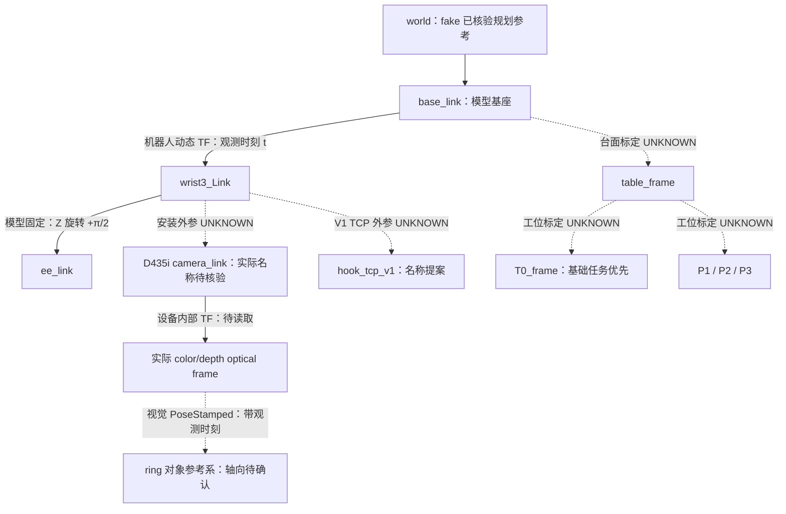

# Calibration / TF / TCP 交接（10/12 更新）

适用：AUBO S3、法兰附近安装的 D435i、V1 舌规。依据任务书第 05 节，交付范围为坐标定义、已有/待测表、离线校验和 10/12 现场标定流程。V2 参数不用于明天 V1。

**当前结论：离线软件/文档与 fake 模型证据核验已有产物；真实内外参、V1 TCP、台面和工位标定尚未完成。** 最终运行验证结果见 [验收记录](docs/calibration/VALIDATION_REPORT.md)。初版分支 `feat/calibration-tf-v1` 已通过 PR #6 合入 main；当前修订分支为 `fix/calibration-side-mount-trial`，最终提交和 PR 以 GitHub 为准。

**10/12 安装选择更新：原交付 PR #6 已合入 main；用户现选定先试“相机带螺孔的窄底面贴蓝色圆盘正面”。此时镜头大致侧向观察，与法兰轴线垂直。旧 `[82.5,0,35.8]` mm 与旧旋转仅保留为历史布局示例，不用于当前试装。** 详见 [当前试装与测量要求](docs/calibration/CURRENT_MOUNT_TRIAL.md)；真实相机安装外参仍 UNKNOWN/null。本修订基于 main `b418515`。

## 1. 阅读基线与确认条件

| 项目 | 已确认内容 | 确认来源 |
| --- | --- | --- |
| 团队仓库 | `F1u0rite/meituan_challenge_ws`，本次修订 main=`b418515`；初版核验 main=`f7eaa2c`、初始基线=`1d940f7` | git fetch 后同步；原交付 PR #6 已合入 |
| 环境 | Ubuntu 24.04 / ROS 2 Jazzy；离线脚本 Python ≥3.10，无 ROS/NumPy 依赖 | 团队 README；本机 Python 3.11.9 |
| 机械臂 | AUBO S3 | 实物照片、团队模型文档 |
| 相机 | D435i，固定安装在法兰附近，随末端运动 | 用户本轮确认 |
| 工具 | 明天使用 V1 舌规 | 用户本轮确认 |
| 真实数据 | 当前没有提供图像、CameraInfo、同步机械臂位姿或标定结果 | 当前交付输入 |

末端 `wrist3_Link → ee_link` 在官方固定模型中有 **+π/2 的 Z 轴旋转**，不能视为相同坐标系。[模型核验及来源](docs/calibration/MODEL_FRAME_AUDIT.md)。常提供的 fake 模型/日志已核验一致，规划运行报告确认 Planning Frame=`world`、EE=`ee_link`；真实部署还需复核，相机 frame 与 TCP 最终名称仍待确认。材料与接入说明见 [FAKE_RUNTIME_AUDIT.md](docs/calibration/FAKE_RUNTIME_AUDIT.md)。

## 2. 坐标链与责任

以下相机/TCP/工位名称为交接提案；实际运行名称以 URDF、消息 Header 和 TF 图为准。未知边不发布零位姿占位 TF。坐标图另提供 [SVG](docs/calibration/frame_chain.svg)。



机器人链由驱动/robot_state_publisher 提供；相机内部 TF 由相机驱动提供，避免重复发布。你负责相机安装外参、TCP 与台面/目标区的定义和标定。视觉负责实际 ring/body 观测，规划负责将已校验位姿和原语转为路径。

## 3. 变换方向与完整姿态

统一 `T_A_B` 表示将 B 系坐标变换到 A 系。`T_B_C × p_C` 得到 B 系中的点；左乘顺序不能交换。

相机为 eye-in-hand，B 为已核验规划参考系，E 为标定选用的实际末端参考系，C 为视觉输出的光学系：

`T_B_ring(t) = T_B_E(t) × T_E_C × T_C_ring(t)`。

若安装外参记录到 camera_link，应再包含 camera_link 至实际 optical frame 的设备内部 TF。仅知道相机装在法兰上，无法把 `T_E_C` 设成单位矩阵。

目标 TCP：`T_B_TCP_goal = T_B_ring × T_ring_TCP_goal`。提环原点、进入方向和目标工具姿态需与孙浩然/常建烁共同确定；当前草案轴向不是实测定论。

规划使用 E 作为末端时：`T_B_E_goal = T_B_TCP_goal × inverse(T_E_TCP)`。若规划已经使用 TCP link，就使用 TCP 目标，避免重复补偿。TCP 偏置含位置与旋转；pivot 法只确定位置，不能自动确定工具朝向。

落座时还要确认 T0 表达的是电池本体目标还是 TCP/提环目标，不能把台面中心坐标直接当成工具接触目标。

## 4. 视觉与规划的数据契约

复用现有 `BatteryDetectionArray` / `BatteryDetection`；不修改 IDL。

- `body_pose` 与 `ring_pose` 均保留完整 `PoseStamped`，包括位置、xyzw 四元数、header.frame_id 和采集时间戳；数组 Header 不替代各 Pose Header。
- 四元数不是 `[0,0,0,0]`；姿态未知则 `ring_pose_valid=false`，不通过任意单位四元数“补齐”观测。
- 位置 m，角度/RPY rad。离线工具要求明确单位标签；它无法从合法数值本身证明设备没有把 mm 错写成 m。
- 四元数顺序同样无法从数值证明：把 wxyz 的 `[1,0,0,0]` 写进 xyzw 字段会被当成绕 X 180° 的合法姿态。ROS 消息与本工具为 xyzw；Eigen `Quaterniond(w,x,y,z)` 构造参数与其 `coeffs()` 顺序不同，部分 SDK 输出 wxyz，转换处需显式核对。四元数导出至少保留 9 位有效数字；工具不静默归一化，|q| 偏离 1 超过 1e-6 即拒绝（四位小数的 0.7071 会被拒）。
- ring 与 body 定义由视觉记录。脚本当前校验 ring Pose，body 不能因同属一条检测消息而直接认定有效。
- TF、观测与 `now` 必须处于一致时基。ROS stamp 用于 tf2；FSM 单调 Clock 用于运行看门狗，两者需孙嘉明的适配层明确转换，不能直接相减。
- 动态 TF 按采集时刻求值，不用“最新机械臂姿态”替代。离线快照无插值，要求动态边时间与观测精确匹配。
- 缺 TF、UNKNOWN 安装/TCP、未校验测量状态、姿态/时间/单位异常时，返回拒绝原因。真正规划拒绝的接入由视觉/规划适配器消费规则；本次未修改它们。

旧 Python `RosPerceptionPort._to_pose()` 只取 XYZ；新 C++ Action 外壳接入时必须保留完整 `Pose6D`。校验工具输出是诊断 JSON，`motion_authorized=false`，不是可发送给执行器的运动 Goal。

## 5. 已有/待测表

[测量清单 CSV](docs/calibration/measurement_inventory.csv) 和 [真实站点清单 JSON](config/calibration/site_inventory.json) 可直接交接。状态：MEASURED 有实测/设备读取证据；ESTIMATED 有模型/CAD 等估计来源；UNKNOWN 无数值，JSON 用 null。

模型固定关节（如 `wrist3_Link→ee_link`）的几何来自模型，记 ESTIMATED；在真实部署下核对实际模型并保存运行时读数（`tf2_echo` 输出与 `robot_description` 哈希）后，可按“已部署 TF 读取”记录 MEASURED，evidence 必须注明范围。这不证明模型符合实物，也不证明物理 F 已对齐。此次 fake 材料另记 FAKE_RUNTIME_CAPTURE，不能将真实清单改为 MEASURED。离线 REAL 诊断要求所经每条边都是 MEASURED，不要为通过诊断而改标签。

| 项目 | 状态 | 下一步 |
| --- | --- | --- |
| 官方末端固定旋转 | ESTIMATED：官方模型与 fake 展开模型已核验一致 | 核对真实部署模型、物理 F 与标定参考系 |
| 规划参考 / 末端 | fake 运行报告：world / ee_link | 现场核对；规划已负责 TCP 逆补偿，勿重复补偿 |
| D435i 彩色/深度内参与内部外参 | UNKNOWN：官方支持设备读取 | 读取本设备/实际流参数，保存版本与分辨率 |
| 末端至相机安装外参 | UNKNOWN | 固定支架后采集手眼数据；CAD 只作 ESTIMATED |
| V1 TCP 位置与姿态 | UNKNOWN | 定义舌规工作点与轴向，分别验证位置/朝向 |
| 台面/官方底图相对基座 | UNKNOWN | 现场选定原点、平面与方向 |
| T0/P1/P2/P3 中心与朝向 | UNKNOWN | 先 T0，再序列工位；保存对象语义与高度 |
| 提环原点与进入方向 | UNKNOWN | 与实物、V1 接合方向、视觉输出一致 |
| 位置/姿态误差及观测年龄阈值 | UNKNOWN | 根据实物余量和实际数据由团队确认 |

相机官网提供的是内部传感器参数，不能直接提供你们的法兰安装外参。[官方参数调查与读取流程](docs/calibration/D435I_OFFICIAL_PARAMETERS.md)。[旧安装候选](docs/calibration/S3_D435I_MOUNT_DESIGN.md) 的前玻璃中心 `[100,0,40]` mm、深度原点 `[82.5,0,35.8]` mm 和旧旋转只适用于其光学轴与 F 对齐的历史布局，现仅供数学回归。17.5 mm 是“1/4-20 螺孔中心线→左 imager”的参考尺寸；合成到当前试装时必须按实际相机轴向旋转，不能照搬平移或只补一个未经核验的 90°。当前底面贴端面的试装待测完整位置和朝向，真实清单仍保留 UNKNOWN。

## 6. 今晚离线复现

在本分支仓库根目录运行；Windows 用 `python`，Ubuntu 用 `python3`。

```bash
python3 -m unittest discover -s tests/calibration -v
python3 scripts/calibration/check_calibration.py examples/calibration/synthetic_case.json
```

合成夹具包括动态腕部姿态、安装偏移、光学系旋转。预期位置约 `[1,1.1,0.05]`，姿态约 `[-0.70710678,0,0,0.70710678]`，`simulation_only=true`，采集 stamp 保留为 `10000000000` ns。这些数值完全是数学夹具，不能作为实机参数（夹具中 camera_link→optical 的零平移也不代表真实彩色相机位置）。

一次性重建全部离线证据（单元测试、文档示例、生成的反例、格式与链接检查），结果写入 `docs/calibration/validation/`，全部符合预期才 exit 0：

```bash
python3 -B scripts/calibration/run_offline_validation.py
```

负面证据：将夹具某安装边改为 `status=UNKNOWN` 且几何为 null，脚本返回 exit 2 / `UNKNOWN_CALIBRATION`；见 [保存的未知外参样例](examples/calibration/unknown_extrinsic_case.json)。

```bash
python3 scripts/calibration/check_calibration.py examples/calibration/unknown_extrinsic_case.json
```

成功 exit 0 仅代表诊断逻辑通过。REAL 快照还要求每条所用边有 MEASURED 与 evidence 引用；工具不能验证引用内容真实性或误差是否达到实物要求。`site_inventory.json` 是待测清单，没有观测，直接当 case 输入会被拒绝，不能据此形成抓取目标。

## 7. 现场 TF 检查命令

加载团队已有 Jazzy 与正确工作空间 overlay，确认 ROS_DOMAIN_ID/use_sim_time 与视觉/机器人一致。这里只读检查，不启动驱动或发送动作。

```bash
ros2 node list
ros2 topic list -t
ros2 topic info /mtc/perception/batteries --verbose
ros2 topic echo /mtc/perception/batteries --once
ros2 run tf2_tools view_frames
ros2 run tf2_ros tf2_echo base_link wrist3_Link
ros2 run tf2_ros tf2_echo wrist3_Link ee_link
```

`tf2_echo A B` 打印 `T_A_B`（B 在 A 中的位姿）。若部署模型与 AUBO 固定提交一致，`tf2_echo wrist3_Link ee_link` 应为平移 0、xyzw≈`[0,0,0.707,0.707]`；不一致时先停下核对模型。另只读保存 `ros2 param get /robot_state_publisher robot_description` 的输出哈希：ROS 2 宏加载的是构建时生成的 `urdf/aubo_S3.urdf.xacro`，它不在 AUBO 固定提交的源码树中，需与 `aubo_S3.urdf` 对比。

`view_frames` 会在当前目录生成图文件，建议在自己的证据目录运行。`tf2_echo` 持续运行，观察后 Ctrl+C；它主要检查可达性，**不能证明每个观测时刻的历史 TF 可用**。确认真实相机 frame 后，同样检查 `wrist3_Link` 至相机机体系及 optical frame。观察多个机械臂姿态时，末端至相机应固定，基座至相机应变化。

实际观测转换应使用 Jazzy tf2 `lookup_transform(target_frame, source_frame, observation_time)`；时间零代表 latest，不应代替相机观测时间。ROS 回调中的等待要避免阻塞 TF 接收。当前分支没有 ROS TF 监听节点，现场命令及适配器集成标 NOT RUN；今晚 P0 用无 ROS 的校验脚本/测试验收。[官方 Jazzy API 来源](https://github.com/ros2/geometry2/blob/jazzy/tf2_ros_py/tf2_ros/buffer.py)。

## 8. 明天顺序与协作

现场详细流程和采集表：[FIELD_SOP.md](docs/calibration/FIELD_SOP.md)。先核验安装和设备参数，再采集手眼/工具数据、台面与 T0，独立误差复核后交规划和集成。P1/P2/P3 表今晚已准备，现场测量可在基础任务之后继续。

- 孙浩然：相机内部参数、光学 frame、图像/深度/标定板观测、时间戳和提环定义。
- 常建烁：实际 Planning Frame、EE link、模型、所需工具姿态和工位语义。
- 孙嘉明：机器人位姿记录、完整 Pose6D 适配、失败传播和 ROS/Core 时间契约。
- 张叔阳：现有节点启动、ROS graph、日志、现场采集/复核记录。

现场阻断：实际相机外参、V1 TCP、T0/台面位姿、提环进入方向与真实定位、时间与历史 TF 连通性。当前规划 backend 查询 latest TF，需先完成采集时间的适配；当前工位规划未消费独立工位朝向。接入责任与参数方向详见 [FAKE_RUNTIME_AUDIT.md §3–4](docs/calibration/FAKE_RUNTIME_AUDIT.md)。这些事项仍待测或待集成，本次没有用占位值消除阻断。
