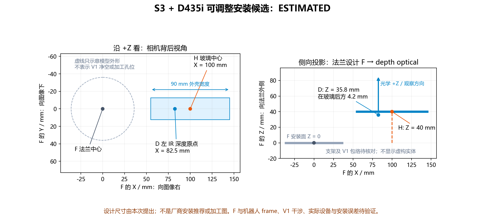

# S3 / D435i 可调整支架：安装候选与设计外参

2026-10-11。用户确认可以按尺寸重新制作或调整支架。本文给出可测量、可复算的安装候选；它是布局提案，不是已核对 V1 干涉的加工定稿或实测手眼结果。

## 1. 官网 / GitHub 查到了什么

| 资料 | 已核验信息 | 能支持的结论 |
| --- | --- | --- |
| AUBO 官方 S3 URDF，固定提交 `47fa5e02fa873f27f7e812d31f31e3f4cf5e56b1` | 机器人运动链、末端 `wrist3_Link`；另由 Xacro 添加 `ee_link`，相对 wrist3 绕 Z +π/2 | 可明确软件坐标关系，不能得到本团队支架尺寸 |
| 同提交 S3 `visual/link6.DAE` | 包含末端视觉网格。按 COLLADA 节点变换，外形约 X ±36 mm、Y -36～39.5 mm、Z -55.61～0 mm | 仅用于初步空间布局与模型参考，不确定孔螺纹、公差、实物版本或定位基准 |
| AUBO 2024 官方目录的搜索索引 | 存在“ AUBO-S3末端法兰 / S3尺寸图”条目；直接 PDF 下载当前失败 | 尺寸图尚未取到并视觉核验，不抄索引碎片中的孔尺寸 |
| 当前 AUBO 开发者 S 系列页面 | 当前列 S2 / S5 | 不把 S2、iS3 或 ES3 的法兰参数代入这台 S3 |
| RealSense D400 2024-10 官方数据手册，337029-017，p146 Figure 10-9 | D435/D435i 外形 90 × 25 × 25.05 mm；背面两个 M3 安装孔，间距 45 mm、最大旋入深度 3 mm、推荐扭矩 0.4 N·m；括号参考尺寸 “(17.5) FROM CENTERLINE OF 1/4-20 TO LEFT IMAGER” | 可定义外壳包络与左 imager 相对**底面 1/4-20 螺孔中心线**的位置。图标注 DO NOT SCALE，**没有**给出 1/4-20、M3 孔对或镜头中心线相对外壳中心的尺寸 |
| 同手册 p93 Figure 4-4、p94 Table 4-16 / §4.8.1 | 深度原点 X/Y 为左 imager 中心；深度零平面相对前玻璃 Z′：D435/D435i 为 -4.2 mm，D435f/D435if 为 -4.7 mm | 可由玻璃基准估计深度光学原点，不用外壳中心代替它；需按机身标签确认型号 |
| realsense-ros `realsense2_description/urdf/_d435.urdf.xacro`，固定提交 `9a11121700cb4780e273e34141f6402fe184321d` | 名义模型（文件自注 approximate）：`camera_link` 相对底面螺孔系为前 10.6、左 17.5、上 12.5 mm；前玻璃比前铝板内凹 0.1 mm；外壳盒以螺孔为宽度中心；optical 相对 camera_link 为 rpy(-π/2,0,-π/2) | 支持“螺孔≈外壳宽度中心、光心≈半高”的名义近似和轴向约定；不含 M3 孔，不是带公差图纸 |

已查看的本地官方 PDF、页面截图和网格投影保存在本项目 `报告附件/官方资料`。末端模型源码哈希见 MODEL_FRAME_AUDIT.md；网格与 PDF 哈希见交付回执。

## 2. 候选安装基准与尺寸

定义物理设计坐标系 **F**：原点为末端法兰安装面的中心；+Z 沿法兰轴线向工具外侧；+X 是安装时明确标记的一条径向方向，+Y 按右手系确定。F 目前不直接等同于 `wrist3_Link` 或 `ee_link`，必须与实际部署模型对齐并保存证据。

定义 **H**：D435i 前玻璃平面上的外壳宽/高中心，坐标轴采用光学轴向。Z 基准是前玻璃面，不是前铝板（官方 ROS 模型记前玻璃比前铝板内凹约 0.1 mm）。由相机背后向前看，+X 向图像右，+Y 向下，+Z 向前。相机顶边因此朝 -Y；不要按面对镜头时的左右反着安装。

候选按以下几何安装，所有尺寸单位 mm：



| 项目 | 候选值 / 要求 |
| --- | --- |
| H 相对法兰中心 F | `[100, 0, 40]` |
| 相机观察方向 | +Z_H 与 +Z_F 平行，朝工具外侧 |
| 图像右向 | +X_H 与 +X_F 平行 |
| 图像下向 | +Y_H 与 +Y_F 平行 |
| 相机宽度方向包络（投影） | F 的 X 约 `[55,145]`；高度 Y 约 `[-12.5,12.5]` |
| 背面 M3 安装孔 | 官方只给 45 mm 孔距、3 mm 最大旋入。若孔对正好以外壳中心对称，X 投影约 77.5 / 122.5 mm、Y≈0——**这是假设**，加工前须在本相机上卡尺实测孔对与 1/4-20 或左 imager 的关系；也可改用 1/4-20 螺孔（数据手册尺寸的基准）定位。实际 Z 安装面另行定义 |

100 mm 侧偏与 40 mm 玻璃前伸是本次提出的布局尺寸，不是 AUBO 或 RealSense 推荐值。相机侧偏让它避开法兰中心的工具安装区域；没有 V1 实物包络时，这还不能证明视野、碰撞或强度满足比赛要求。视线是否能看到环也取决于观测姿态与 V1 遮挡。

支架可采用法兰转接件加侧伸托板/可调相机座，安装时用机械量具定位玻璃中心 H，调整到上述轴向后锁紧。支架的材料、厚度、法兰孔位、定位销及紧固承载需机械成员依据实物接口和 V1 装配定稿。相机后壳并非前玻璃；不要直接把“40 - 25.05”当成精确的 M3 安装面 Z 尺寸。加工孔位应以安装面基准图/CAD或实测确定。

相机 M3 **旋入壳体深度**不得超过官方图中的 3 mm；螺钉总长还包含支架/垫片厚度。安装时留出 USB 接头与弯线空间。本文没有给出 S3 法兰孔钻孔坐标或支架强度结论。

## 3. 根据候选几何推算外参

`T_A_B` 把 B 系坐标映射到 A 系。由相机背后看，左红外 imager 位于**底面 1/4-20 螺孔中心线**的 -X 方向 17.5 mm（p146 参考尺寸；右 imager 在 +X，1/4-20 位于左、右 imager 之间）。深度零平面在前玻璃后方 4.2 mm（D435/D435i）。H→D 因此由以下分量组成：

| 分量 | 取值 | 依据 / 状态 |
| --- | --- | --- |
| 左 imager 相对 1/4-20 中心线（X） | -17.5 mm | 数据手册参考尺寸 |
| 1/4-20 中心线相对 H（X） | 0 | **假设**：图中未标注；官方 ROS 名义模型同样近似为外壳宽度中心 |
| 左 imager 光心相对 H（Y） | 0 | **假设**：镜头中心线 `-C-` 未标注到外壳边；官方 ROS 名义模型取半高 |
| 深度零平面相对前玻璃（Z） | -4.2 mm（D435/D435i）；-4.7 mm（D435f/D435if） | 数据手册 Table 4-16 |
| `R_H_D` | 单位阵 | **假设**：无光轴相对外壳的角度公差 |

所以本次采用的 **名义** `T_H_D`（D 为 depth optical）平移为 `[-0.0175,0,-0.0042]` m，旋转为单位阵。它包含参考尺寸和对齐假设，精度不能由小数位数推断。`derive_nominal_mount.py` 在输出 `assumptions` 中逐项列出这些状态；若实测得到 1/4-20 或镜头中心线相对 H 的偏移，可用 `screw_axis_x_in_H_m`、`imager_axis_y_in_H_m` 代入（结果仍为 ESTIMATED）。

`T_F_D = T_F_H × T_H_D`：

```text
T_F_depth_optical =
[[1,0,0,0.0825],
 [0,1,0,0     ],
 [0,0,1,0.0358],
 [0,0,0,1     ]]

translation_m = [0.0825, 0, 0.0358]
quaternion_xyzw = [0, 0, 0, 1]
status = ESTIMATED
```

这是一组 **法兰设计 F → 深度光学系** 的完整设计外参。只有安装达到约定尺寸/朝向时，它才代表对应名义装配。不能将这些数字直接填成现有相机的实测外参。

官方 ROS Wrapper 的 `camera_link` 名义原点为左 IR，轴向为 X 前/Y 左/Z 上，和 depth optical 的 X 右/Y 下/Z 前不同。若运行内部 TF 与该约定一致，则：

```text
T_F_camera_link_nominal:
  translation_m = [0.0825, 0, 0.0358]
  quaternion_xyzw = [0.5, -0.5, 0.5, 0.5]
```

**不能把光学系的单位四元数复制给 camera_link。** 对彩色图/对齐到彩色的深度输出，还必须按设备内部 TF 接到实际 color optical frame，不能把 depth optical 参数直接当成 color optical 参数。驱动已提供的内部 TF 不重复发布。

若现场证实 F 与实际 `wrist3_Link` 完全重合，上述 camera_link 外参才可解释为 `T_wrist3_camera_link`；否则先使用核验后的 `T_wrist3_F` 合成。若改以 `ee_link` 为父系，则应再左乘官方 `inverse(T_wrist3_ee)`，不能忽略其 +π/2 旋转。

复算命令，输出始终 ESTIMATED / `deployment_ready=false`：

```bash
python3 scripts/calibration/derive_nominal_mount.py examples/calibration/nominal_mount_design.json
```

设计 JSON 必须写明 `camera_model`（`D435`、`D435i`、`D435f` 或 `D435if`），以选用对应的深度零平面偏移。修改玻璃中心坐标或四元数即可重算侧偏/倾斜方案；离法兰超过 1 m 的输入会被当作 mm 误写成 m 拒绝。该 JSON 不属于实测站点配置，也不能作为 `check_calibration.py` 的 REAL case。实际站点清单里的安装外参仍为 UNKNOWN。

## 4. 按方案安装后的最短闭环

1. 机械成员核对 S3 实物法兰接口与 V1 外形，确认本候选可装、视野无挡、接头有空间；不满足时调整 100/40 mm 和朝向并重算。若支架用背面 M3 孔定位，先在本相机上卡尺测量孔对相对 1/4-20 或左 imager 的位置。
2. 以明确标记的法兰 F 测量玻璃中心 H 与三轴方向，锁紧并拍照、记录。F 的 +X 建议绑定到法兰定位销孔等物理特征，并在 RViz/TF 中与 `wrist3_Link` 的 X 轴对照；确定 `T_robotEE_F`，注明采用的 URDF 提交与实际父 frame。F 的偏航每错 1°，相机原点约偏 1.4 mm，0.3 m 处目标再偏约 5.2 mm；把 `wrist3_Link` 与 `ee_link` 弄混会差 90°（相机原点约 117 mm）。
3. 核对机身标签型号（D435i 与 D435if 的深度零平面相差 0.5 mm），读取这台相机的内参、实际帧名与内部 TF，确认视觉使用 depth 还是 color optical；在仿真/RViz 检查相机姿态与实物方向。
4. 按 FIELD_SOP.md 采集不同姿态的手眼数据，并以未用于求解的点/姿态验证。暂用 CAD 外参时仍记录 ESTIMATED 和验证误差，不能仅因按图安装就标 MEASURED。
5. 误差达到团队根据舌规与提环余量确定的要求后，交规划/集成使用有效标定版本。任务允许的误差当前未知。

1° 安装角误差在约 0.3 m 观测距离上会带来约 `0.3*sin(1°)=5.2 mm` 的横向误差；这是几何估算，说明名义装配应保留验证步骤，不是本设备误差测量。

本候选的名义观测几何（均需按实物与 V1 核对，不是可装性结论）：

- 最小深度（数据手册 §4.6 Table 4-11，D435/D435i）：1280×720 为 280 mm、848×480 为 195 mm、640×480 为 175 mm、424×240 为 105 mm。深度零平面在 F 的 z=35.8 mm，所以目标需距法兰面约 316 / 231 / 211 / 141 mm 以上才有深度；舌规接合瞬间若更近，应先定位再接近，现场姿态由规划成员确定。
- 左侧无效深度带（数据手册 Figure 4-2）：深度图左侧有一条只被左 imager 看到的无效带，物方宽度约等于基线 50 mm，像素宽度随距离减小。本候选中 F 的 z 轴在图像左侧，名义上约在 87–140 mm 深度内落入该带，只与 424×240、480×270 的可用深度区间重叠。若不想受影响，可把相机放在 F 的 -X 侧或绕光轴转 180°，使工具轴落在图像右侧（备选，不替换默认方案）。
- 视场：深度 HFOV 87°、彩色 HFOV 69°（p69 Table 3-49）；彩色光轴距 F 的 z 轴约 67.5 mm（名义）。使用对齐到彩色的深度时以彩色视场为准。
- USB：官方 ROS 名义模型中 USB-C 插头沿光学 +X 伸出外壳端面约 35 mm（本候选中远离法兰，至 F 的 x≈180 mm），未含弯线半径。

## 5. 来源

- [AUBO S3 官方固定 URDF](https://github.com/AuboRobot/aubo_description/blob/47fa5e02fa873f27f7e812d31f31e3f4cf5e56b1/urdf/aubo_S3.urdf)
- [末端 Xacro](https://github.com/AuboRobot/aubo_description/blob/47fa5e02fa873f27f7e812d31f31e3f4cf5e56b1/urdf/xacro/inc/aubo_ros2_macro.xacro)
- [S3 官方末端视觉网格](https://github.com/AuboRobot/aubo_description/blob/47fa5e02fa873f27f7e812d31f31e3f4cf5e56b1/meshes/aubo_S3/visual/link6.DAE)
- [RealSense 官方数据手册 2024-10](https://realsenseai.com/wp-content/uploads/2024/10/Intel-RealSense-D400-Series-Datasheet-October-2024.pdf)，已下载并渲染核对 p93/94/146
- [RealSense ROS Wrapper 坐标说明](https://github.com/realsenseai/realsense-ros#ros2robot-vs-opticalcamera-coordination-systems)
- [官方 D435 名义模型 `_d435.urdf.xacro`（固定提交 9a111217）](https://github.com/realsenseai/realsense-ros/blob/9a11121700cb4780e273e34141f6402fe184321d/realsense2_description/urdf/_d435.urdf.xacro)、[USB 插头模型](https://github.com/realsenseai/realsense-ros/blob/9a11121700cb4780e273e34141f6402fe184321d/realsense2_description/urdf/_usb_plug.urdf.xacro)
- [AUBO 开发者 S 系列页面](https://developer.aubo-robotics.cn/hardware/robot_arm_s.html)
- [AUBO 2024 目录索引线索](https://aubocdn.aubo-robotics.cn/official_website/hardware/AUBO_Robotics_ZH_202410_Catalog.pdf)，本轮直接获取失败，未作为孔位数值依据
