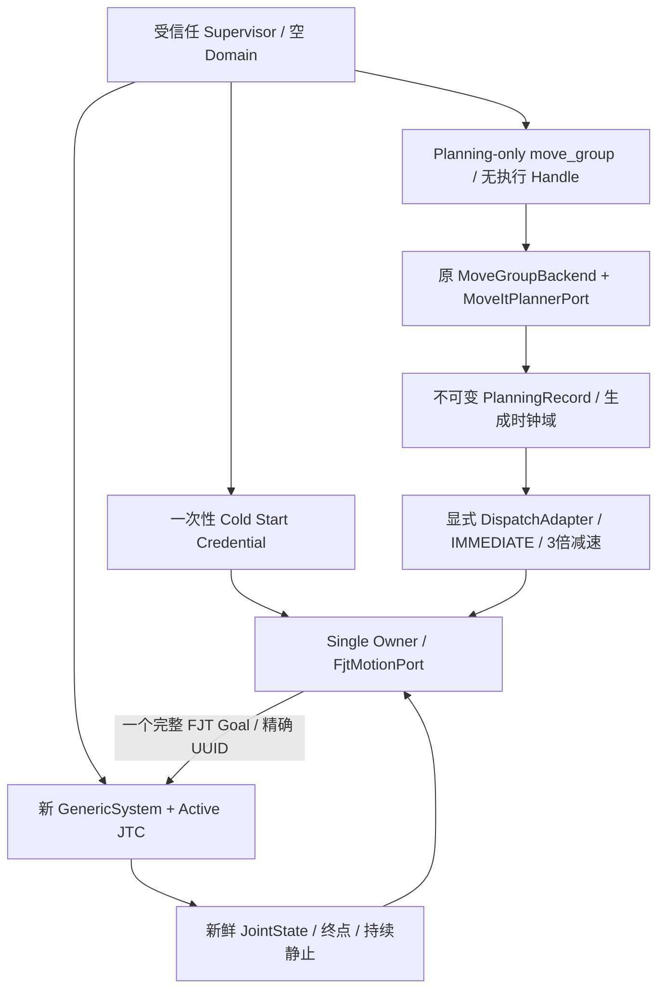

# Phase 2C P0：Single Execution Ownership & Planner–FJT Integration

日期：2026-10-12。仅隔离 LOCALHOST DDS、Fake ROS Action 与原生 GenericSystem。
真实机器人、SDK/RPC/RTDE、工具 IO、完整 PickPlace/Task 联调均 **NOT RUN**。

## 结论与 Git 基线

**PASS：受信任 Fake 冷启动的有限单执行者架构、planning-only、显式时间契约及原生联合执行。
PASS：510 项普通 GTest 与510项 UBSan；原478项身份保留，新增32项。**

- 当前分支：`feature/phase2c-single-execution-owner`，从最新 Phase 2B 创建。
- 基线及远端 Phase 2B：`681bb64bfb8cd482d1e78950cef4cfe395b21bff`。
- fetch 后 main 仍为 `f7eaa2c0d2887aeada4fd635112c63c237962ff7`；没有合并 PR #4，
  没有假定其 Planning Scene 功能存在。
- 实现提交 HEAD：`09b03339dcfc868f5e42a306c855acfd94249d1d`。
- 本报告/证据随后另行提交；最终文档 SHA 由
  `git log -1 --format=%H -- docs/migration/PHASE2C_P0_EXECUTION_OWNERSHIP_REPORT.md` 查询。
- 开始时工作树干净，本地和远端 Phase 2B 相同；仅其他成员 perception 远端引用更新，
  未改动其分支。没有 push、merge main、修改 PR #7 或修改原分支历史。

这不是跨进程强互斥、安全急停或实机安全认证。依赖受信任的进程、受控新启动和隔离
Domain；DDS 图存在发现延迟、同 Node client 对象计数合并等限制。

## 环境与实际调用链

Ubuntu 24.04 / ROS 2 Jazzy / GCC 13 / C++17。实际安装版本：

| 包 | dpkg 实际版本 |
|---|---|
| rclcpp_action | 28.1.22-1noble.20260912.162328 |
| moveit_ros_move_group | 2.12.4-1noble.20260915.202214 |
| controller_manager | 4.48.1-1noble.20261006.035021 |
| joint_trajectory_controller | 4.42.1-1noble.20260924.190511 |



没有新 FSM；没有将完整轨迹拆为 ExecuteJointMove；Phase 2A 默认 Mock 未改变。

## 单执行者的证据来源及状态

A. **启动建立**：自己的 Supervisor 先启动宿主。Factory 观察三秒仅自身 Node，且无
目标控制服务/Action、JointState 或直接轨迹发布者。要求非默认独立 Domain、LOCALHOST、
无 static peers/自定义或隐式 DDS profile。签发绑定 Node/Domain/端点的一次性对象，
一秒内消费。其后 Supervisor 才启动新的、静态证明 GenericSystem 的控制器和 planning-only
move_group。没有接管既有 JTC，没有预热 Goal，没有人工空 Status。

B. **派发/身份**：运行期仍查询 GenericSystem、Active JTC/broadcaster、完整六关节
position/velocity 状态接口及 position 占用；JS 新鲜/静止；目标 FJT Server/Client各1，
控制服务各1，JS Publisher1，直接轨迹 Publisher0。原命令完整身份不可变。
排队、Handle 未到是 GOAL_PENDING/Unknown；保存所有已观测活动 UUID，不能 count==1
认领。Handle 关联原请求精确 UUID，所有取消固定该 Handle。外部/非法证据锁定，
不能抢占未知 Goal，不能 global cancel。

C. **终结**：Action Result 与 controller SUCCESSFUL 不是完整成功证据。还须关联
Feedback、按名称终点、新鲜 JS、位置差分/速度阈值、终态后的持续静止窗口。
原生 GenericSystem position-only 模式的速度状态可能为零，因此位置差分检查仍保留。
这些均为模拟证据，不能推广到实机。

D. **故障/释放**：证据冲突或丢失、额外 Client、控制器/hardware变化、关联 Feedback
失效、JS失效或超时锁定；只取消自己的 Goal。迟到 Result 不清锁，不发送下一条。
Port 销毁保留原 quarantine，凭据不能复用或绑定其他 Node。脚本没有自动恢复/重启。
仅正常结果及当前停稳证据允许该实例继续；故障后的重部署需要操作者处理，并销毁
原受控 Fake 部署，不能在任意已有图中重建 Port 绕过锁。

状态：VERIFYING_ENVIRONMENT → EXCLUSIVE_READY → GOAL_PENDING → GOAL_OWNED；
取消 STOP_PENDING；故障 FAULT_LOCKED。ready 必须在内部授权提交后才能公开。

**局限**：三秒图观察不能证明不存在尚未发现或恶意参与者；上述条件不是 DDS 认证，
也不是原子“查询空闲并占有”。同 Node 外部 Client 的局限仍在，活动 UUID 证据用于
额外冲突检测。本模型只适用于当前受信任的 Fake 部署，其他中间件未验证。

## 原生 Status 契约

原默认两参数 FJT 构造函数保留 Phase 2B 严格行为：未收到、非法或接收证据过期，拒绝。
新三参数构造函数必须显式消费冷启动凭据。该路径不从“没有 Status”推导 idle；idle
基线来自上面的受控新启动。Status 仍被订阅、检查合法性和外部 UUID，冲突粘性锁定。

原生 Status 是事件式观测，不要求它周期发布。Own Handle/Result、关联 Feedback、
Controller/Hardware 查询、新鲜 JS及超时管理生命周期。缺失 Status 不充当授权，
静默也不单独否定已验证的部署授权。Snapshot 的 status_fresh 仍只表示本地接收年龄。

所有 pending 时观察到的活动 UUID 跨更新保留。已收到明确 Own terminal Result 后，
其精确 UUID 的迟到旧 Active Status 不再阻止已独立停稳的本实例；不能忽略任何其他
活动 UUID。未获 Handle 的未知状态永远不认领。

实际 cold-start 输出 status_received=0/status_fresh=0，只有 controlled=1 并且全部
环境条件通过才 ready=1。没有发布虚假的 Status 或让标准 JTC 增加心跳。

## MoveIt Planning-only 的真实验证

新包内新增 PlanningOnlyManager，返回空 Controller 列表、空 Handle、inactive 状态，
拒绝 switch；不创建任何 Action Client。设 allow_trajectory_execution=false，关闭
controller management。实际 ROS 图目标 FJT Server1/Client1，move_group 未创建
/ moveit_simple_controller_manager 的目标客户端。

不能直接把 manager 字符串设空：安装版启动执行管理器时异常；不能删除
/execute_trajectory：现有 MoveGroupInterface 初始化等待该 Action。
因此保留的是**不可执行的兼容入口**。实际以规划轨迹请求此入口，收到
ABORTED / CONTROL_FAILED，FJT Goal0。随后才由 FjtMotionPort 执行。

[MoveGroupInterface 源码](https://github.com/moveit/moveit2/blob/jazzy/moveit_ros/planning_interface/move_group_interface/src/move_group_interface.cpp)
支持上述等待行为；[执行 Capability](https://github.com/moveit/moveit2/blob/jazzy/moveit_ros/move_group/src/default_capabilities/execute_trajectory_action_capability.cpp)
在没有执行管理器时返回失败。参数成功、服务存在或“不调用 execute()”本身不算隔离证明；
本轮运行图和实际拒绝响应才是验证证据。

## Planner/FJT 时间与能力契约

| 时间 | 本轮含义 |
|---|---|
| Observation Time | JointState 的 ROS stamp；独立检查新鲜度、严格增加和位置/速度 |
| Planning Generation Time | Planner 注入 SteadyClock 的 stamp；PlanningRecord 原样保存并标记域 |
| Trajectory Time From Start | 完整轨迹各点相对时间；首点必须0、严格递增 |
| ROS Scheduled Execution Time | 只在显式 ROS_SCHEDULED 时采用 ROS 时间，不使用生成时间 |
| FSM Watchdog Time | 原单调时钟不变；本宿主没有 FSM，也不修改其看门狗 |

DispatchAdapter 明确 IMMEDIATE 后复制轨迹、设置执行副本 stamp=0、分配独立 session/
sequence ID；原记录不变。未知时钟/策略（含非法枚举）、NaN/Inf、未来/过期生成时间
拒绝。宿主最大规划年龄5秒；默认 adapter 2秒。当前实际是 Steady 约66455秒，ROS约
1.79175e9秒，二者没有相互冒充。

本轮位置能力来自 S3 URDF 与 ros2_control 源的交集：
±2π/±π/±2.41/±2.66/±2π/±2.23 rad。Supervisor 展开只读 Xacro 并逐项比较；双方
RobotModel 使用同一交集，而不是靠增大探针 ±0.5rad 来让任何轨迹通过。

原探针窄约束下 IK 失败；额外 JointConstraints 在此安装配置中采样效果不稳定。
把审查后的边界加载到模型，避免冗余路径约束，保留相同实际位置要求。
[RobotModelLoader](https://github.com/moveit/moveit2/blob/jazzy/moveit_ros/planning/robot_model_loader/src/robot_model_loader.cpp)
支持 min/max position 参数加载。没有修改 Planner/驱动算法或关闭碰撞检查。

实际空间目标是当前状态的明确小关节偏移 FK，仅 Synthetic。原始规划点不丢失。
宿主显式固定3倍均匀减速：t×3、v÷3、a÷9；重算 deadline，并完整重复位置、速度、
加速度、Bernstein spline、起点、时长和 timeout 校验。速度0.2 rad/s、加速度0.5 rad/s²
的软件上限未放宽。保留 scaling、6D intent、frame、所有路点、simulation_only，
requires_contact=true 仍拒绝。

部分 IK 长分支确实产生70–140秒规划；三次未派发重新规划仍不合能力则 BLOCKED，
零Goal。不会自动重试运动，不缩短时间、不删除检查。该规划可有效但超出当前执行能力。

上游控制器部分 min/max 仍是 `{±2*pi}` 文本、控制器报告解析/限位警告。本轮没有
修改驱动，不能宣称控制器自身限位全部可靠；软件执行器的全段约束是额外 Fake 防线。

## 本轮新发现的 P0 与中间失败

1. 原生配置的空 manager 导致 MoveIt 启动异常；禁止执行 Capability 又使 MGI 等待。
   均未派发 FJT Goal。采用无执行 Handle 插件及失败兼容响应后实测通过。
2. 新测试捕获 snapshot ready 早于内部 authority_established 提交的竞态；修复后先
   提交授权才公开 ready。外部 Client 即使后来消失，也不会重新放行。
3. 一轮普通回归的 ConcurrentGoalsSingleOwner 实际120秒超时、未生成正常XML。
   原始输出 `/tmp/phase2c_full_timeout_preserved.log` 及 colcon历史目录保留。
   静态检查发现 Port mutex → Action Goal mutex 与 Action callback → Port mutex 的
   反向锁序；没有取得该超时的运行堆栈，不能称为栈级死锁复现。旧单例重复40次未复现。
   [安装协议对应的 Client 实现](https://github.com/ros2/rclcpp/blob/jazzy/rclcpp_action/include/rclcpp_action/client.hpp)
   在内部锁内调用反馈回调，并在发令/取消路径使用同一锁。
   修复为有界出站队列：锁内固定 Session/UUID，锁外调用 send/cancel；每次最多一个
   send和一个scoped cancel，原 FSM线程不等待轨迹。派发前再验证环境和调度时间。
   异常关联原Session，不污染新Goal；关闭时只处理自己的取消。新增多线程压力用例通过。
4. 新压力用例最初错误地假设取消已到终点，第二Goal因真实Fake状态仍为起点而拒绝。
   修正用例的起点后，五次Goal/各一次取消均通过，没有覆盖当前JointState。
5. 第一版 mismatch 场景曾被 timeout/capability 提前拒绝，却只检查“被拒绝”。该
   误标 PASS 排除，改为先证明原始规划可执行、整条空间路径平移测试偏差，并严格匹配
   start mismatch 原因。最终原生 GenericSystem 零Goal、正确原因通过。

以上失败没有删除日志；最终验证均使用修复后实际执行数据，不把中间结果混为PASS。

## 原生 GenericSystem 联合验收

只读驱动安装 install_no_symlink，实际 Domain210–228及最终220，全部LOCALHOST/
rmw_fastrtps_cpp，无 static peers/profiles。静态唯一 GenericSystem，运行硬件服务同样
确认 plugin，JTC/broadcaster Active，六关节接口/状态完整。只有自己的受控进程被终止。

[实际运行摘录](evidence/phase2c_p0/generic_system_summary.log)，完整原始日志在各段列明
的 /tmp 目录。下面不是 Fake Server 替代结果：

| 要求 | 原生结果 | Goal / Cancel |
|---|---|---|
| 1 Cold Start，无初始Status | PASS，凭受控新启动取得有限授权 | 0 / 0，随后场景派发另计 |
| 2 Planning Only | PASS，完整规划及 MoveIt执行入口拒绝 | 0 / 0 |
| 3 Coexistence | PASS，Server1/Client1/Topic publisher0；Controller Active | 无额外Goal |
| 4 Complete Trajectory | PASS，完整15点单Goal，成功/独立停稳 | 1 / 0 |
| 5 Start Mismatch | PASS，明确 planned start differs，零发令 | 0 / 0 |
| 6 Expired Plan | PASS，明确 generation expired，零发令 | 0 / 0 |
| 7 Foreign Client | PASS，Client2、ready=false，不能抢占 | 0 / 0 |
| 8 Cancel Own Goal | PASS，准确UUID，初次停止确认false，终态后独立确认 | 1 / 1 |
| 9 Status Silence | PASS，事件数不增加、接收证据过期，但有限部署授权仍有效 | 1 / 0 |
| 10 Fault Lock | PASS，运动中额外Client触发Own cancel；unknown/lock保持，第二Goal拒绝 | 1 / 1 |

第7/10项只创建外部 Client，不向其发送额外运动Goal。真实外部活动UUID及乱序由本地
Fake Server异步用例覆盖，未在原生JTC上另行发出Foreign运动，该子项 **NOT RUN**。

最终交付构建的额外执行复验（/tmp/phase2c_delivery_execute）：

```text
HARDWARE plugin=mock_components/GenericSystem verified=1 controllers_verified=1
GRAPH servers=1 clients=1 direct_publishers=0 foreign=0 status_received=0 status_fresh=0 ready=1 controlled=1
MOVEIT_EXECUTION_DENIED controller_failed Goals=0
DISPATCH policy=IMMEDIATE original_stamp=66455.4 dispatch_stamp=0 retime_factor=3 duration=12.9643 timeout_ms=20447
RESULT success=1 stop_confirmed=1 status_unknown=0 fault_locked=0 Goals=1 Cancel=0
UUID=838566c3ba26f6d5e792e88bca026f75 feedback=259 stationary_samples=45 stationary_seconds=0.21997
```

六关节 actual/goal 按名称分别一致：
0.019756、-0.0490335、0.0726283、-0.0251738、0.000719584、0.0170761 rad。
全部完整点一次发送，没有 ExecuteJointMove 分点或硬编码 MotionResult.success。

**FAIL：move_group正常退出子检查**。部分运行仍在SIGINT后由Launch升级SIGTERM，
child exit -15；Launch自身exit0不是正常退出证明。GenericSystem控制进程正常结束。
此问题未扩张修复，不能把关闭软件进程作为停稳证据。
驱动源/安装5656个已有文件SHA256前后相同，未修改其预存状态或配置。

## 构建、回归、Sanitizer

最终构建9/9依赖包 PASS，包含要求的所有 C++、新包和接口依赖；没有宣称完整16包
Python工作空间本轮重新构建。普通与UBSan各8包实际测试：

| 包 | 每轮独立GTest PASS |
|---|---:|
| mtc_core_cpp | 23 |
| mtc_task_cpp | 87 |
| mtc_manipulation_cpp | 120 |
| mtc_motion_execution_cpp | 88 |
| mtc_ros2_action_cpp | 40 |
| mtc_moveit_planner | 29 |
| mtc_trajectory_execution_cpp | 102（30校验 + 61原Action + 11新ColdStart） |
| mtc_phase2c_integration_cpp | 21（20时间/派发 + 1插件） |
| 合计 | 510，FAIL0/ERROR0/SKIP0，29个实际执行文件 |

verify_results.py 固定681bb64原478项，源码声明/二进制注册/XML三方核对，全部原身份
注册并完成，新增32项；重复40次诊断和压力用例内部五次循环不作为额外测试数。
Python269/E2E15是旧报告数字，本轮 **NOT RUN**；TSan **NOT RUN**，旧失败保留。

```bash
source /opt/ros/jazzy/setup.bash
colcon --log-base log/phase2c_delivery build --packages-up-to \
  mtc_phase2c_integration_cpp mtc_ros2_action_cpp --parallel-workers 2
source install/setup.bash
colcon --log-base log/phase2c_delivery test --packages-select \
  mtc_core_cpp mtc_task_cpp mtc_manipulation_cpp mtc_motion_execution_cpp \
  mtc_ros2_action_cpp mtc_moveit_planner mtc_trajectory_execution_cpp \
  mtc_phase2c_integration_cpp --executor sequential
python3 src/mtc_trajectory_execution_cpp/test/verify_results.py --build-base build
```

独立UBSan目录 build/phase2c_ubsan、install/phase2c_ubsan；最后日志 log/phase2c_ubsan_delivery。
使用 -fsanitize=undefined、-fno-sanitize-recover=all、-fno-omit-frame-pointer，
exe/shared链接相同sanitizer，UBSAN_OPTIONS=halt_on_error=1:print_stacktrace=1。
9包构建、8包测试及510项身份核验真实PASS；系统ROS/DDS/MoveIt库未全部重新插桩，
原生运动验证采用普通构建，不能说全部系统组件UBSan认证通过。未更改ASLR。

最终记录 /tmp/phase2c_delivery_{build,test,identity}.log 与
/tmp/phase2c_ubsan_delivery_{build,test,identity}.log。全部各包scoped结果单独检查。
保留历史全目录汇总存在14 errors/14 failures（旧audit_tsan/final_gate_tsan），不可当作
本轮失败，也没有删除它们来制造PASS。中间本轮失败保留在独立colcon日志目录。

## 新增32项测试身份

- `ControlledStart.ExistingGraphCannotMintAuthority`
- `ControlledStart.CredentialCannotBeReused`
- `ControlledStart.ColdNativeServerWithoutInitialStatusExecutesOnce`
- `ControlledStart.NativeStatusSilenceDoesNotRevokeAuthority`
- `ControlledStart.NewForeignClientLocksAndReconstructionCannotBypass`
- `ControlledStart.PendingOwnHandleNeverClaimsForeignUuid`
- `ControlledStart.AssociatedFeedbackLossLocksEvenWithFreshJointState`
- `ControlledStart.CancelAcknowledgementRequiresIndependentSettlement`
- `ControlledStart.DiscoveryOverrideCannotMintAuthority`
- `ControlledStart.CredentialBoundToOriginalNode`
- `ControlledStart.ConcurrentPollingAndRepeatedScopedCancelRemainBounded`
- `Dispatch.ExplicitImmediateKeepsOriginalGenerationStamp`
- `Dispatch.ExpiredPlanRejected`
- `Dispatch.SteadyClockNotInterpretedAsRosTime`
- `Dispatch.NoImplicitImmediateAuthorization`
- `Dispatch.ValidRosScheduleRetainsTime`
- `Dispatch.PastOrDistantRosScheduleRejected`
- `Dispatch.AllWaypointsAndDerivativesPreserved`
- `Dispatch.DispatchIdentitiesUnique`
- `Dispatch.UnknownClockRejected`
- `Dispatch.StartMismatchRejected`
- `Dispatch.ContactRejected`
- `Dispatch.NonFiniteGenerationRejected`
- `Dispatch.StaleCurrentStateRejected`
- `Dispatch.SplineSafetyCheckRetained`
- `Dispatch.ExplicitUniformSlowdownPreservesOriginalAndSpatialPath`
- `Dispatch.ExplicitRetimingTransformsDerivatives`
- `Dispatch.InvalidRetimingRejected`
- `Dispatch.RetimingCannotBypassPositionOrSplineLimits`
- `Dispatch.UnrecognizedPolicyCannotBecomeImplicitImmediate`
- `Dispatch.UnrecognizedClockCannotBecomeRosTime`
- `PlanningOnly.NoExecutionHandlesOrControllers`

## 修改范围、接口与合并建议

新增包 mtc_phase2c_integration_cpp：CMake/package.xml、DispatchAdapter、拒绝执行的
Controller Manager plugin、single_owner宿主、planning-only Launch、只读Fake Supervisor、
两组GTest与README。FJT包改动：头文件新增显式凭据/诊断，执行权策略和出站队列、
11项ColdStart测试、测试FakeController提取为共享测试头、CMake注册与身份核验基线。
原test_fjt_action的61项测试主体保留，没有删除Goal所有权负面用例。
本报告及真实运行摘要另行提交。

未改Planner源码、Core/FSM、MotionExecutor、Phase2A源码、ROSIDL、旧Python、
官方驱动及其他成员分支。ExecutionSnapshot布局扩展，需要C++消费者重建；两参数
构造函数/Core API/ROSIDL没有破坏性替换。公共头依赖已导出，真实宿主链接构建通过。
Python脚本语法、ROS package manifest解析、plugin加载、相对Markdown链接及diff检查通过。

仍需处理：

- **BLOCKED：当前PR #7直接合并。** 远端681bb64尚不含本轮发现的Action mutex出站队列
  修复；应先由负责人评审并把此P0修复带入Phase2B，再重新确认其回归。不得以本地
  stacked分支通过来宣称远端PR已经修好，本轮没有自动修改或合并PR。
- **FAIL：move_group正常退出**，需后续处理系统组件关闭；不影响本次已终结且独立停稳
  的正向轨迹证据，但故障路径关闭不代表安全停机。
- **BLOCKED：完整FSM异步Stop Bridge、完整PickPlace/Task宿主**，没有直接接入本轮。
- **NOT RUN：真实硬件、工具/感知/标定、PR#4Scene、其他DDS中间件、TSan与Python/E2E本轮回归**。
- 规划可能选择长IK分支，三次不合能力仍BLOCKED；不存在“任意Planner输出都能执行”的保证。
- 有限受信任部署模型不是强身份认证/跨进程原子互斥；发现冲突只能保守停止自己的Goal，
  不能证明未知参与者不会在发现窗口内发令。不得推广到实机执行授权。

**建议创建Phase2C stacked PR供审查**，清楚标注基于681bb64、包含本轮P0修复、
有限Fake部署假设及上述局限。当前不建议直接合并未更新的PR#7，也不建议跳过代码审查
合并Phase2C。P0最小Fake联合闭环已完成，可在审查及基线修复后继续软件集成；
这不是实机准入或完整抓放准入。完成本任务后停止，没有自动push/PR/merge或实机操作。
