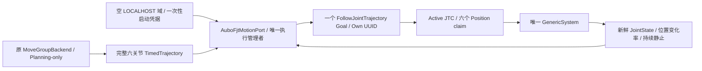

# PR #14 → AUBO ROS 2 GenericSystem 轨迹执行集成

## 最终结论

**代码接线、C++/UBSan 回归及最终九类原生 Fake 功能验收 PASS；MoveIt 正常退出 FAIL；总体验收 FAIL/BLOCKED。真实硬件 NOT RUN。**

实际完成原 MoveGroupBackend → MotionCommand → AuboFjtMotionPort → 标准 FollowJointTrajectory → 官方 GenericSystem 的非接触完整轨迹执行。没有用 Fake Action Server 替代这一原生执行，也没有把进程退出当作停稳。

本轮不是完整 V1 PickPlace 抓放验收。原 FSM 的注入接口已经提供，但原生探针独立调用规划与执行端；没有伪造 Perception、Tool 或 placement evidence。

## 分支与基线

- GitHub API 实际确认 PR #14 为 merged/closed，合入其规划功能分支，不是 main；merge commit `0825d1b08842997c5152319a85739e11731bdf7c`。
- PR head：`feature/v1-gazebo-simulation`，`00f60bf2dd68112bd35b1d52f41515a56320d05b`。
- 新开发分支：`feature/pr14-aubo-fake-fjt`。
- 独立工作树：`/tmp/mtc_pr14_aubo_fake_20261014`。交付提交以该分支 `git log -1` 为准，基线保持上述 PR head。
- 原工作区、main、原 PR 分支和视觉集成工作树未修改；未 Push/Merge。
- 受控启动和关联反馈 watchdog 的复用来源为既有 `22b0607948c3e58568870da866287d23c135a9fb` 的语义增量，不整分支合并、不覆盖原 Gazebo Runner。

现场 Domain 91 的已有官方 Fake 进程 PID 52409/52414 保持运行，本轮不接管或停止它们。新实验均为 LOCALHOST、rmw_fastrtps_cpp、独立域，静态及运行时插件严格要求 `mock_components/GenericSystem`。

## 修改范围与接线

新增 [mtc_aubo_fake_integration_cpp](../../src/mtc_aubo_fake_integration_cpp/README.md)：

- `include/.../aubo_fjt_motion_port.hpp`、`src/aubo_fjt_motion_port.cpp`：实现原 MotionPort，持有唯一底层 FjtMotionPort；完整轨迹、规划 frame 和命令身份检查。
- `include/.../fsm_injection.hpp`：绑定现有 PickPlaceFsm 依赖，不改变状态表、不创建第二个执行者。
- `src/aubo_fake_probe.cpp`：当前测量起点 → 小幅 FK 目标 → 原 MoveGroupBackend → 原轨迹转换 → 显式减速 → 完整校验 → 单 Goal；Planner 与执行 Node/Executor 隔离。
- `src/planning_only.cpp`、`planning_only.xml`：MoveIt 不提供任何 Controller Handle，不创建 FJT 执行客户端。
- `launch/aubo_fake.launch.py`、`scripts/run_aubo_fake.py`：受控新域启动、自有进程管理、独立证据、失败退出传播。
- `test/test_aubo_command.cpp`（14 项）、`test/test_aubo_action.cpp`（8 项）：纯转换与真实 rclcpp_action/MultiThreadedExecutor 的身份/取消/超时/并发验证。
- `CMakeLists.txt`、`package.xml`、README。

既有 FJT 包增量：

- `fjt_motion_port.hpp/.cpp`：一次性受控冷启动凭据、环境/Context 校验、原生事件 Status 契约、关联 Feedback watchdog、已终结 Own UUID 跟踪及诊断。
- `execution_state.hpp`：追加硬件/Controller/authority 诊断字段；消费者需同 Overlay 重编译，不能混合旧 ABI。
- CMake 注册 `test_controlled_start`；新增 21 项真实 ROS Action 测试及其 FakeController 夹具。

原锁外出站队列、发送前起点复核、Callback Group 生命周期保护、完整命令比较、默认禁用执行及默认严格 Status 构造路径保留。

`mtc_simulation`、MoveIt Planner、FSM Core、ROSIDL、Phase 2A 源码均未修改。没有修改 `/opt/ros`、官方驱动配置或参考工作空间。

## 执行权和异常处理

启动前必须先观察空域，凭据与 Node/Domain/Endpoint 绑定且仅消费一次，Supervisor 随后启动新 Fake 实例。不能在任意已有 ROS 图中推断 idle 并获取执行权。Graph 不是认证或跨进程原子锁；同 Node 多 Client 的计数局限也保留说明。

原生 JTC 无初始 Status 的事实不被伪造；受控模式依赖明确启动边界和持续硬件/Controller/JointState 证据。默认严格 Status 模式不变，未知活动 UUID 不认领。

Goal Response 延迟/超时保留原 Session；取得迟到 Handle 后只关联并取消其原 UUID。取消出站锁外执行；旧 ID 不升级为 global stop。ACK、终态、独立停稳分开。执行异常进入 FAULT，迟到 Result、删除 Port 或重建不能自动解除 quarantine。

JointState 按名称映射，拒绝维度错误、缺字段、非有限、时间过期/回退；起点差异拒绝，绝不自动跳到轨迹首点。正常成功还需 Controller 成功终态、最终位置一致和新鲜持续静止。

## 模型、时间和轨迹能力

同一官方已修复 Fake Xacro 展开结果同时供 Controller 和 MoveIt 使用，SHA256：`f705c358002426fb6337835d22f02c40a4dbdbe4803984e908c9d05e43d29b72`。只把结果写入新 `/tmp` 证据目录，不调用参考 Launch 中可能写模型的 ensure 路径。

Planning Frame 为 world；本探针 TCP 明确为 `ee_link` 裸工具 FK，**没有把它称为现场 V1 TCP 验收**。完整 V1 工具/接触任务需原宿主提供其已验证模型、TCP 和真实放置证据。本轮所有接触请求仍拒绝。

位置限位为模型与已审查控制器能力的交集：shoulder ±2π、upperArm ±π、foreArm ±2.41、wrist1 ±2.66、wrist2 ±2π、wrist3 ±2.23 rad。测试请求进一步约束每轴在实际测量起点 ±0.15 rad 内。软件速度/加速度能力均为 0.2（rad/s、rad/s²），不是通过扩大探针限位获取 PASS。

目标为本轮测量值的小幅偏移 FK，绝不导入旧 Gazebo trajectory/home/初始关节目标。测量值恰好为六个零时也保存其真实时间戳；这是当前 Fake 反馈，不是默认零目标。

完整保留所有关节、路点、速度和加速度。显式 uniform slowdown=3 后，时间 ×3、速度 ÷3、加速度 ÷9，并重新执行 Bernstein spline、位置/导数、起点和 deadline 校验；不拆分 Goal。

原始规划生成时间独立记录为 monotonic，执行副本明确 immediate ROS stamp=0；旧规划/状态仍拒绝。没有把 SteadyClock 当 ROS 调度时间。

## 最终原生 GenericSystem 结果

每个场景一个新域/证据目录，均使用实际 ros2_control/JTC，而非 Fake Action 测试替身。

| 场景/目录 | Domain | Functional | Goal | Cancel | StopConfirmed | FaultLocked | Teardown / Overall |
|---|---:|---|---:|---:|---|---|---|
| plan_04：冷启动、Planning-only | 205 | PASS | 0 | 0 | 无命令证据 | false | FAIL / FAIL |
| expired_03：过期生成记录拒绝 | 206 | PASS | 0 | 0 | 无命令证据 | false | FAIL / FAIL |
| foreign_02：第二 Client 拒绝 | 207 | PASS | 0 | 0 | 无命令证据 | true | FAIL / FAIL |
| execute_03：完整非接触轨迹 | 208 | PASS | 1 | 0 | true | false | FAIL / FAIL |
| cancel_01：Own UUID Cancel | 209 | PASS | 1 | 1 | true | false | FAIL / FAIL |
| identity_01：已完成 ID 改内容拒绝 | 210 | PASS | 1 | 0 | true（原操作） | false | FAIL / FAIL |
| silence_01：原生 Status 无周期心跳 | 211 | PASS | 1 | 0 | true | false | FAIL / FAIL |
| fault_01：直接轨迹 Publisher 冲突门禁 | 212 | PASS | 1 | 1 | false | true | FAIL / FAIL |
| mismatch_02：首点与反馈不一致 | 213 | PASS | 0 | 0 | 无命令证据 | false | FAIL / FAIL |
| ubsan_execute_01：UBSan 项目 Overlay | 214 | PASS | 1 | 0 | true | false | FAIL / FAIL |

fault 模式不发布任何直接轨迹消息，只创建冲突端点。未知停止结果继续 FAULT，第二命令拒绝。各自有进程最终清理；不以 SIGTERM 或进程消失声明 stop_confirmed。

正常实测：7 点，9.079715376 s，FJT Server 1 / Client 节点 1 / Direct Trajectory Publisher 0 / JointState Publisher 1。Goal UUID `367bbabab762f265c064f15aaf04bec8`，181 条关联 Feedback，终态后持续静止 `0.259954376 s`，误差六轴均为 0 rad。

| 关节 | 最终测量 rad | 终点误差 rad |
|---|---:|---:|
| shoulder_joint | 0.020000002459427648 | 0 |
| upperArm_joint | -0.11290178241513384 | 0 |
| foreArm_joint | -0.08048523644029573 | 0 |
| wrist1_joint | -0.11758328000808735 | 0 |
| wrist2_joint | 0.019999955319308114 | 0 |
| wrist3_joint | 0.009999825885679733 | 0 |

六轴位置都有变化。GenericSystem 报告速度字段全为 0（运动期间也如此），因此不能将该字段本身当真实速度证明。执行器额外利用新鲜位置差分、终态和持续窗口验证软件停稳；仅对这个模拟实例有效。

取消 UUID `996e82ae238e6852cf1c852ca53f0f40`，ACK 后继续观察，终态后静止 `0.260071342 s` 才确认。FAULT UUID `a6b3a519bbb42f9234ae1d975d610534` 虽收到 ACK 和终态，仍保持 fault_locked=true、stop_confirmed=false。

## 保留的失败与根因边界

1. 首轮编译：缺 Action include、同一行多次 EXPECT_THROW 导致 GTest 标签冲突。已修正；初始日志保留。
2. plan_01/02：启动前 MoveIt 模型/日志辅助节点使域非空，正确拒绝且未启动 Driver。改为启动前纯 URDF 解析；凭据消费后才加载 MoveIt。
3. execute_01：并行编译期间记录到 JointState 接收最大间隔 0.333503439 s，超过 0.3 s 门禁，Goal 0 / FAULT。没有放宽阈值。并行负载与现象相关，未独立证明根因；不抹去这次失败。
4. 首轮 AuboAction 负面夹具把 timeout 设为 180 ms，小于合法轨迹/静止期限，实际为 admission rejection。改为 600 ms 并断言请求进入 Pending，随后真实复现迟到 Response/UUID Cancel；原 XML 保留。
5. expired_01、foreign_01、expired_02：规划未返回，Supervisor 有界终止，probe 为 -9。节点隔离本身没有解决这一问题；不能把它写成 FJT mutex 死锁。
6. 父进程 GDB、零运动 `diagnostic_gdb_expired_01` 实际抓栈：线程 1 位于安装版 `MoveGroupInterface::computeCartesianPath()` 的 Future 等待；同轮 move_group 日志已计算 1 点/0% Cartesian path，但明确报 `failed to send response ... (timeout): client will not receive response`。官方 [2.12.4 客户端源码](https://github.com/moveit/moveit2/blob/2.12.4/moveit_ros/planning_interface/move_group_interface/src/move_group_interface.cpp) 中该路径使用未带 deadline 的 Future 等待。没有修改上游源码。
7. 最终非接触 FREE_SPACE 选择 `prefer_straight_line=false`，避免可选 Cartesian RPC 优化，仍由原后端进行有界关节目标、碰撞和末端限速检查。最终九类功能通过；**一般 Cartesian/接触规划的 RPC 可靠性仍 BLOCKED**。
8. 所有原生阶段的 move_group SIGINT 正常退出 FAIL：实际退出 -15 或 -11，并有 SIGTERM 升级记录。安装版 MoveIt 生命周期问题没有在本轮修复，不使用 NODELETE、永久泄漏、_exit、插件 pinning 或假退出码制造 PASS。
9. 新 Launch 的失败传播首轮使用本 Jazzy 不存在的 RaiseError 导入，负面测试发现后改为退出回调抛 RuntimeError。复测实际 Launch exit=1，目录重用拒绝，原 24 个证据文件 SHA256 不变。原错误日志保留。

## 构建、测试身份与 Sanitizer

九个相关依赖包完成构建：core、task、manipulation、motion_execution、interfaces、Planner、Phase2A、FJT、新包。初始一轮新包编译失败后修正，最终增量构建通过；普通和 UBSan 使用独立目录，不清空历史构建。

普通与 UBSan 都核对实际注册清单和 XML：**553 项独立 GTest / 33 个可执行文件，FAIL 0 / ERROR 0 / SKIP 0**。PR #14 本基线 510 项全部保留，本轮新增 43 项：ControlledStart 21 + AuboCommand 14 + AuboAction 8。

原核验脚本仍额外保证历史 478 项身份；它输出“新增 75”，含 PR14 已有 32 项，不能全部算本轮新增。没有将 CTest 包装记录或重复执行计为新身份。

| 包 | 普通/UBSan 独立 GTest PASS |
|---|---:|
| mtc_core_cpp | 23 |
| mtc_task_cpp | 87 |
| mtc_manipulation_cpp | 120 |
| mtc_motion_execution_cpp | 88 |
| mtc_moveit_planner | 53 |
| mtc_ros2_action_cpp | 40 |
| mtc_trajectory_execution_cpp | 120 |
| mtc_aubo_fake_integration_cpp | 22 |

新增真实 Action 测试：FullTrajectoryAndIndependentStopEvidence、CancelBeforeResponsePreservesOwnUuid、LateResponseAfterTimeoutCannotBecomeOrphanOrUnlock、CancelAcknowledgementWhileMovingCannotConfirmStop、StaleJointStatePreventsGoal、ChangedCompletedIdentityNeverSendsAgain、WrongFrameAndStartDoNotSendGoal、ConcurrentRequestsHaveSingleOwner。

UBSan 九包构建 96 s；八包回归 103 s；最终宿主增量构建 17.9 s。原生 UBSan execute Functional PASS，Teardown FAIL（第三方未修复环境）。TSan NOT RUN；UBSan 不是数据竞争证明。既有全量 Python、Python E2E、Gazebo 动态验收 NOT RUN；本轮未复用其历史数字宣称 PASS。

colcon 还实际执行了 Planner 的 5 项 `test_shutdown_evidence.py` 数学/日志契约测试，普通与 UBSan 均 PASS；这不是安装版 move_group 正常退出 PASS。`colcon test-result` 的 592 包含 553 项 GTest、5 项 pytest 和 34 项 CTest 包装记录，独立 GTest 仍为 553。

新增 package.xml 经 catkin_pkg format-3 解析验证，git diff --check 通过。现有 Planner/FSM/ROSIDL/Gazebo 代码差异为空。

## 证据目录

- 所有原生数据：`/tmp/mtc_pr14_aubo_fake_evidence_20261014/`，每轮独立目录。
- 每轮：static_proof.json、robot.urdf、trajectory.json、joint_states.jsonl、functional.json、processes.json、teardown.json、summary.json、实际 probe/controller/move_group 日志。
- 普通构建/测试：`/tmp/mtc_pr14_aubo_fake_build_20261014/{build,install,log}`。
- UBSan：`/tmp/mtc_pr14_aubo_fake_ubsan_20261014/{build,install,log}`。
- 原身份并集：`normal_identity_union.json`、`ubsan_identity_union.json`（在原生证据根目录）。
- 核验输出：`/tmp/mtc_pr14_aubo_fake_identity_{normal,ubsan}.log`。
- 首轮 Aubo Action 失败：`aubo_action_first_failure/`。
- 精确线程栈和 RPC 超时：`diagnostic_gdb_expired_01/probe.log`、`move_group.log`。
- 直接附加自有进程抓栈因 ptrace 限制失败，错误保留；改为 GDB 父进程，未更改系统 ptrace/ASLR。
- 残留核验：`final_cleanup.json`，当次 135 个自有进程组无残留，现场 Domain91 两个既有进程仍运行。
- 实际拒绝覆盖和 Launch 非零退出：`launch_overwrite_rejection_v2.log`。

没有覆盖任何历史失败证据，没有把 Launch 父进程 exit=0 当 move_group 正常退出。最新 Launch 已显式传播 Supervisor Overall FAIL 为非零退出。

## 交付与下一步

构建/运行/API/FSM 注入与 AUBO Sim 边界见 [新包 README](../../src/mtc_aubo_fake_integration_cpp/README.md)。模块已具备独立 GenericSystem 单 Goal 非接触执行能力；可审查软件候选和功能证据，但**不建议将整体运行验收标为 PASS 或直接提升为实机/V1 完整抓放入口**。

需要先处理 move_group 生命周期退出失败，并对 Cartesian RPC 增加真正有界的调用/超时契约后才能开放该能力。本轮保留非接触 FREE_SPACE 通路和全部安全门禁，不重写 Planner 或修改第三方 MoveIt。

完整 V1 FSM/Tool 接触与放置证据、真实 TCP 模型、异步 FSM Stop Bridge、真实 AUBO 后端均未在本轮验收。AUBO Sim 若使用其他插件/SDK，仍被当前 GenericSystem 白名单拒绝，须另行授权和建立独立安全契约。
