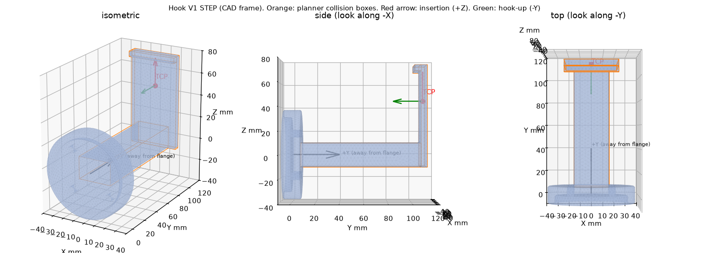

# V1（被动舌规）预对准：按 CAD 重算后的结论

> 常建烁，2026-10-12。全部结果来自 Mock / Fake 仿真，**未在真机运行**。工具几何来自 `舌规V1.STEP`（CAD 名义值，ESTIMATED）；
> 提环位置、提环朝向仍为 PLACEHOLDER。

## 0. 更正

上一版结论"home 到 V1 预对准要转 180°、物理下限 31.4 s、必须改状态机"**是错的**。原因是当时没有工具图，我把 TCP 设成
"插入方向 = 法兰轴线"。实际的舌规舌头**垂直于法兰轴线**伸出：法兰朝下时舌头本来就是水平的，不需要大角度转向。

## 1. 舌规几何（`舌规V1.STEP`，SolidWorks 2022，2026-09-29，单位 mm）



| 部分 | 尺寸 | CAD 位置（+Y 为离开法兰方向） |
|---|---|---|
| 安装盘 | Ø75 × 15；背面 Ø63 × 7 凹槽套在 ISO 9409-1-50 法兰（外径 63）上；4 × Ø6.1 孔，孔距 Ø50（M6） | y −7.5 ~ 7.5 |
| 立柱 | 30 × 20，倒角 R2 | y 7.5 ~ 107.5 |
| 舌板 | 宽 44 × 厚 5，沿 +Z 伸到 75 | y 107.5 ~ 112.5，z −10 ~ 75 |
| 倒钩 | 舌尖 5 mm 高的挡边，朝法兰（−Y）翘起 | z 70 ~ 75 |

实体体积 122.9 cm³（铝约 0.33 kg，打印件约 0.15 kg，材料未知）。法兰朝下时：舌板水平、在法兰下方约 110 mm，倒钩朝上。

## 2. 规划器的修改（`feature/planning-v1-feasibility`，只改 `mtc_moveit_planner`）

| 项 | 取值 | 状态 |
|---|---|---|
| TCP（挂环点） | 舌板中线、厚度中面、舌尖后 30 mm：CAD (0, 110, 45) mm → ee_link (45, 0, 110.5) mm | ESTIMATED |
| TCP 姿态 | z = 舌头伸出方向（插入方向），x = 倒钩方向（朝法兰） | ESTIMATED |
| 安装角 | 舌头沿 ee_link +X（`tool.mount_yaw_deg: 0`）；孔位每 90° 对称，可装 0/90/180/270° | **PLACEHOLDER** |
| 贴合面 | 凹槽底面（CAD y = −0.5 mm）贴法兰端面；若外缘贴合需改为 −7.5 mm | ESTIMATED |
| 碰撞体 | 安装盘（圆柱）、立柱、舌板、倒钩（长方体），每次规划附着在 ee_link 上 | ESTIMATED |
| 插入 / 退钩行程 | 60 mm：预对准时舌尖离提环中心 30 mm，插入后提环落在挂环点（倒钩内侧 25 mm） | 需与工具模块一致 |
| 钩口朝上 | 侧插时只取提环的插入轴，绕轴滚转按"倒钩朝上"确定，不用感知给的滚转 | — |

V2 没有 CAD：`sequence_v2_override.yaml` 关闭工具模型，TCP 仍为单位变换占位，行程 30 mm。

## 3. 结果（Fake MoveIt，**状态机未改**）

证据：[`evidence/20261012_032828/`](evidence/20261012_032828/)（提交 `0e0c0f4`）

| 项 | 结果 |
|---|---|
| V1 单块电池（安装角 0°） | **7 段全部成功**；`side_insert` **13.31 s**（上限 24 s），几乎不用转（峰值角速度 0.0075 rad/s），规划 0.01 s |
| V2 单块电池 | 7 段全部成功（不变） |
| 工具碰撞反证 | 法兰离桌面 9 cm、舌规会插入桌面：带工具模型**被拒绝**；关掉工具模型同一目标可规划 → 舌规外形确实参与碰撞检查 |
| 固定位姿、场景隔离、桌面碰撞反证 | 全部 PASS |
| 测试 | 7 个 C++ 包 539 项，0 失败（新增工具模型 5 项、端口 1 项） |

安装角的影响（同一占位提环，插入方向 = 世界 +X，`mount_yaw/`）：

| 舌头装法 | 预对准 `side_insert` | 结论 |
|---|---|---|
| 0°：舌头朝插入方向 | 13.31 s | ✅ |
| 90° / 270°：差 90° | 20.63 s / 19.53 s | ✅ 但余量小 |
| 180°：舌头朝反方向 | 无可行解（最好的候选也需约 41 s） | ❌ |

**结论：V1 不需要改状态机，前提是"机械臂在扫描 / 起始姿态时，舌头大致朝向要插入的方向"。**
这是装配和场地布置的事：装舌规时选对 4 个孔位里的哪一个，以及电池提环朝哪边。

## 4. 需要现场确认

| 项 | 为什么 | 找谁 |
|---|---|---|
| 舌规装在法兰上的方向（0/90/180/270°） | 决定预对准是 13 s 还是不可行 | 现场装配 + 韩明赫 |
| 法兰端面贴的是凹槽底面还是外缘 | TCP 沿法兰轴差 7 mm | 现场看 |
| 挂环点与插入行程 60 mm | 规划假设的"插入后位置"要和真正执行插入的一方一致 | 孙嘉明 / 工具模块 |
| 提环坐标定义（插入轴、从哪一侧插） | 感知只给 180° 周期的方向，分不清从哪侧插 | 孙浩然 + 韩明赫 |
| **谁执行插入、退钩这 60 mm** | V1 舌规没有电机，插入 / 退钩其实是机械臂动作；目前 ToolPort 只有 Mock，规划模块又不为工具原语出轨迹 | 孙嘉明 |
| 真实提环位置 | 本文所有秒数都基于占位提环 | 感知 / 现场 |

## 5. 状态机拆分提案（PR #10）的定位

拆分（快速接近 + 低速预对准）**在安装角 0/90/270° 时不需要**。它只在"舌头要掉头"（180°）或插入方向和舌头朝向差很多时有用，
保留为备选草案，**不建议现在合并**。

## 6. 旧分析（已被取代）

`scripts/analysis/v1_reorientation_feasibility.py` 与 [`evidence/20261012_022117/`](evidence/20261012_022117/) 是在"插入方向 = 法兰轴线"的
占位 TCP 下做的，结论（180°、64 种几何中 55 种不可达）**不适用于真实舌规**，只作为历史记录保留。
末端限速时间最优参数化、就绪位求解、同状态看门狗累计这三项改进仍然有效。

## 7. 复现

```bash
MTC_RMW=rmw_cyclonedds_cpp bash src/mtc_moveit_planner/scripts/run_planning_evidence.sh
# 安装角敏感性：extra_params_file 里设 tool.mount_yaw_deg: 90.0 / 180.0 / 270.0
ros2 launch mtc_moveit_planner plan_tool.launch.py program:=plan_battery_sequence extra_params_file:=<override.yaml>
```
