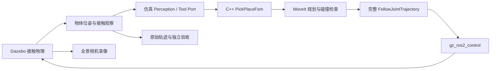
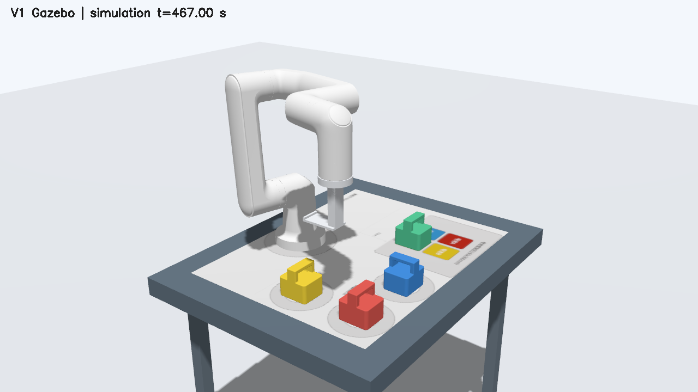
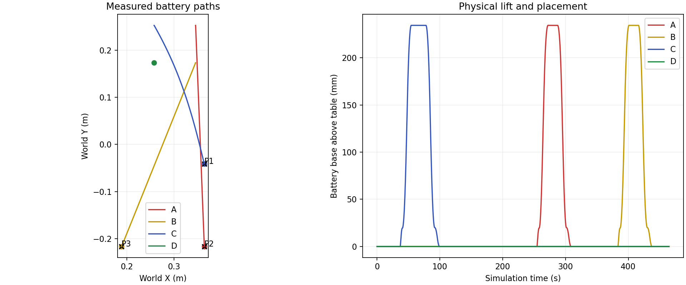

# V1 被动舌规仿真与实机交接

本分支在 Ubuntu 24.04 / WSL、ROS 2 Jazzy、Gazebo Harmonic 上运行原始电池与任务场景。
Ubuntu 22.04 旧工作区只作为资产来源。运行入口与依赖安装见
[mtc_simulation 使用说明](../../src/mtc_simulation/README.md)。

## 已实现的链路

基础任务将一块电池放入 T0；顺序任务按输入的三个不同字母依次放入 P1、P2、P3。
命令行负责顺序编排，每块电池运行仓库现有的 `PickPlaceFsm` 和 V1 策略。
本轮执行验收覆盖 A→T0 和 C→P1、A→P2、B→P3；其他颜色/顺序尚未逐项执行，
不能把命令行接受输入当作对应点位已经通过可达性或物理验收。无解或碰撞会拒绝执行。
公共 FSM / Action IDL 不修改。外层 ROS Task/PickPlace Action 与本仿真适配器的统一接线
仍需后续集成；本报告不把它列为已验证功能。

Gazebo 机械臂模型开启自碰撞；MoveIt 同时检查规划路径中的自碰撞和环境碰撞。
电池只受 Gazebo 的重力、碰撞和摩擦作用。观察插件不改位姿、不施加抓取力，
也不创建工具与电池之间的固定连接。MoveIt 中的附着载荷只用于规划碰撞检查。
当前感知使用 Gazebo 真值；录像来自真实运行的仿真相机，尚未替换成图像识别结果。

## 模型与规划约束

- 电池 STEP、V1 STEP、底图与 14 个官方机械臂网格均有来源和哈希记录，见
  [资产清单](../../src/mtc_simulation/assets/provenance.json)。官方网格逐一核对了上游 Git blob 哈希。
- 电池为 70 × 80 × 80 mm，把手开口约 50 × 18 mm，舌片宽 44 mm、厚 5 mm。
  工具安装角相对 `ee_link` 采用名义 270°（-90°），由配置明确记录。
  `wrist3_Link → ee_link` 另有 +90° 固定变换，两者合成后工具与 `wrist3_Link` 的名义 Z 轴转角为 0°。
  名义 `ee_link → TCP` 为
  `Rz(270°) × Trans(0.045, 0, 0.1105) × Ry(90°)`，长度单位为 m。
- 桌面高 0.650 m，机械臂安装高度 0.651 m。桌面、电池、目标圆坐标保留原始场景定义。
  MoveIt 桌面接触容差为 0.3 mm，载荷底面内缩 0.5 mm；物理模型没有对应的穿透捷径。
- 左列从 -X 侧预对准 45 mm，舌尖离把手边缘的名义间隙仅 2 mm；右列从 +X 侧预对准 60 mm。
  左列抓取后在空中转向 90°，放置后沿 -Y 退出 60 mm；右列沿 +X 退出。
- 顺序场景从 C 左侧预对准点上方的待机姿态开始。该姿态经过 IK 和碰撞检查，
  其关节值保存在 `config/sequence.json` 和每次运行的 `scenario.json`。
  在仿真中设置初始关节值不代表实机已经执行了到达该姿态的运动。
- 接近规划包含目标把手横梁。只有试提时允许 `v1_hook` 与该横梁接触，保留其他碰撞关系。
  已放置的电池在下一次规划中作为障碍物更新。携带时采用包含把手的完整载荷包络。
- 基础任务搬运 TCP 高度为 1.00 m；顺序任务采用 0.95 m，避免更靠外的 A 点位超出可达范围。
- 空载预对准将肩关节目标限制在 ±π，并为左右抓取选择已经验证的肘部构型。
  起点与中间路径仍采用完整物理限位，以便空载时转回工作范围；携带电池时不尝试跨解支跳转。
- 关节限制取仓库已有控制器与 URDF 的交集。IK 排序先剔除碰撞目标；可选的全关节种子
  搜索不扩大关节范围。仿真设置启用该搜索，公共后端默认仍关闭全关节种子扩展。

## 验收定义与证据

验收同时要求 FSM 返回成功和原始物理轨迹通过独立检查：确有抬升、最终中心误差小于
15 mm、底面高度误差小于 2 mm、保持竖直且连续稳定至少 3 s。请求顺序、目标槽位、
角速度数据和接触穿透也参与检查。电池外接圆直径约 106.3 mm，不能完全放入直径
80 mm 的内圈，因此本验收不声称比赛内圈得分。

每次运行保存完整发出轨迹、FSM 事件、50 Hz 物理观察的采样记录、独立验收 JSON、
相机录像、截图和进程退出状态。子进程崩溃不会被 ROS launch 的 0 返回码掩盖。
启动器默认使用本机 UDPv4 通信，并记录实际 RMW/transport 环境。重复启动时曾观察到控制器未收到
`robot_description` 的超时；该运行会失败退出，不发送任务。UDPv4 的含义见
[Fast DDS 官方说明](https://fast-dds.docs.eprosima.com/en/v2.14.7/fastdds/rtps_layer/rtps_layer.html)。
`--pin-moveit-plugins` 启用已记录的 MoveIt 2.12.4 插件退出修复；详见
[退出审计](../planning/MOVE_GROUP_SHUTDOWN_AUDIT.md)。

2026-10-12 端到端验证通过。以下精度为 Gazebo 真值下的仿真结果，不是实机精度。

| 用例 | 放置 | 试提上升 | 最终中心误差 | 最终连续稳定 |
|---|---|---:|---:|---:|
| 基础 | A → T0 | 19.501 mm | 0.036 mm | 28.92 s |
| 顺序 | C → P1 | 19.499 mm | 0.014 mm | 366.92 s |
| 顺序 | A → P2 | 19.501 mm | 0.040 mm | 157.52 s |
| 顺序 | B → P3 | 19.501 mm | 0.041 mm | 28.66 s |

两轮均满足 `result.success=true`、独立 `acceptance.passed=true` 和 `run.shutdown_clean=true`；
所有进程退出码为 0。未记录到超过 1 mm 的非预期碰撞或工具接触穿透。
三次顺序放置分别通过 FSM 的 3 s 稳定门槛，表中的更长时间来自整轮原始轨迹复算。

独立构建 5 个相关包通过；284 项 C++ GTest 和 14 项 Python 测试通过
（colcon 汇总 321 项结果，包含套件汇总）。另验证了非仿真配置拒绝启动、运行中物理反馈中断
触发取消与 FAULT。测试没有连接控制柜。

证据和复算命令见 [证据索引](evidence/v1_20261012/README.md)。
完整录像保存在工作区 `outputs/v1_validation_20261012/basic_A_final/overview.mp4` 和
`outputs/v1_validation_20261012/sequence_CAB_final/overview.mp4`。

## 实机前需要对齐的输入

| 项目 | 当前仿真输入 | 实机交接需要 |
|---|---|---|
| 工具 | V1 名义 CAD、270° 安装角 | 实测安装角、TCP、舌片/把手间隙；确认实物与 CAD 一致 |
| 工作台 | 原始 SDF 的世界坐标 | 基座、桌面、目标圆及相机坐标标定 |
| 负载 | 电池 0.4 kg、工具 0.25 kg、摩擦系数 0.8 | 实测质量/重心；确认承托、转向及退出时的摩擦行为 |
| 感知 | Gazebo 真值；固定全景相机 | 真实相机识别、手眼标定、时间戳和丢失处理 |
| 执行 | Gazebo 位置伺服；专用仿真 FJT 客户端 | 已审查的真实执行适配器、反馈、关联取消与停稳证据 |
| 力学 | 接触动力学 | 真实机械臂力矩能力、工具强度与实测接触响应 |

仿真程序拒绝非仿真配置，不加载真实 AUBO 驱动。下一阶段应在完成上述模型与接口对齐后，
依次验证实机低速空载、插入/退出、短距试提和单块搬运，再扩展到三块顺序任务。
仿真中的成功轨迹不能直接作为未经标定的实机轨迹发送。
